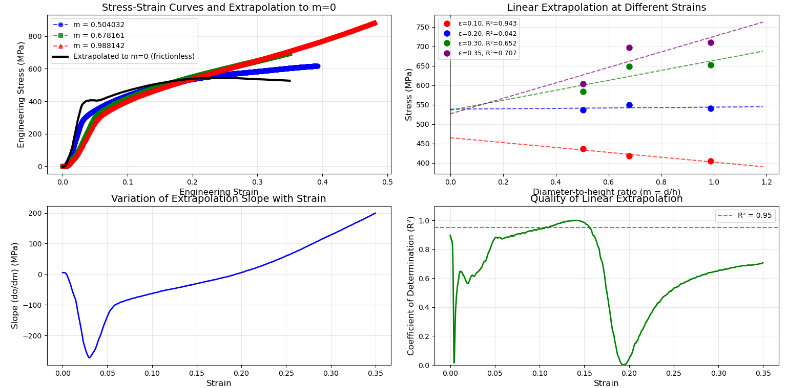

# Frictionless Stress-Strain Curve Extrapolation

## Overview
This repository contains a Python-based computational analysis tool designed to determine the **frictionless stress-strain curve** of metallic materials (specifically tested on Aluminum samples: Al20, Al15, Al10) during compression testing. 

In compression tests, friction between the sample and the platens induces a barrel-like deformation, causing the measured flow stress to be artificially higher than the true material response. This project corrects for this effect by evaluating samples with different diameter-to-height ratios (\(m = d/h\)) and mathematically extrapolating the data to a frictionless state (\(m = 0\)).

This project was developed as part of an academic course in Materials Science / Solid Mechanics to demonstrate the application of computational methods in experimental data correction.

## Methodology

The pipeline follows a rigorous mathematical approach to isolate the frictionless stress-strain behavior:

1. **Data Preprocessing:** Raw CSV data (Strain, Stress) for three different aspect ratios is loaded. Duplicate strain values are cleaned by averaging their corresponding stress values to ensure a single-valued function.
2. **Cubic Interpolation:** Since the raw data points for each sample do not perfectly align, a cubic interpolation is performed to map all datasets onto a common, uniform strain grid. This ensures a point-by-point comparison.
3. **Linear Extrapolation to \(m=0\):** For every discrete strain value on the common grid, the stress is plotted as a linear function of the ratio \(m\). A linear regression is fitted, and the stress at \(m=0\) (the y-intercept) is extracted. This intercept represents the true frictionless stress.
4. **Statistical Validation:** The quality of the extrapolation is validated using the Coefficient of Determination (\(R^2\)) at each strain step to ensure the linearity assumption holds true.

## Output Visualizations

The script generates a comprehensive 4-panel figure providing deep insights into the correction process:


*(Figure: (Top-Left) Stress-strain curves for varying m and the extrapolated frictionless curve. (Top-Right) Linear extrapolation at specific strains. (Bottom-Left) Variation of slope \(d\sigma/dm\). (Bottom-Right) Statistical quality (\(R^2\)) of the extrapolation).*

## Requirements

Ensure you have Python 3.8+ installed. Install the required dependencies using:

```bash
pip install -r requirements.txt
```

## Usage

1. Place your raw CSV data files (`data_m1.csv`, `data_m2.csv`, `data_m3.csv`) in the root directory. 
   *(Note: The CSV files should not have headers. The first column must be Strain and the second column must be Stress in MPa).*
2. Run the analysis script:
```bash
python interpolation.py
```

## Outputs

Upon successful execution, the script provides:
- An interactive Matplotlib visualization of the stress-strain curves and statistical quality.
- A generated CSV file named `friction_corrected_curve.csv` containing the cleaned, interpolated strain data, the extrapolated frictionless stress, the slope, and the \(R^2\) values for further use in finite element simulations or material modeling.

## License
This project is licensed under the MIT License.
